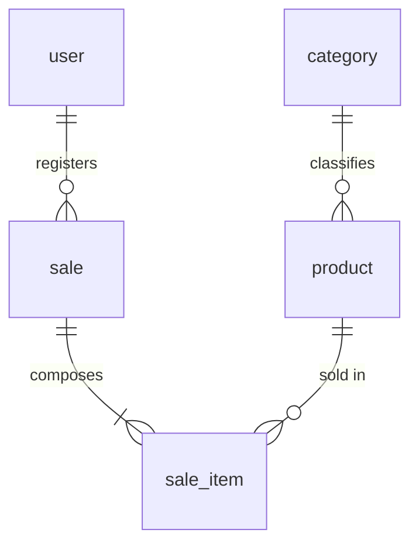

# Entities and Business Rules — Simple Stock Flow

> **Single source:** [`spec/data-model.md`](../spec/data-model.md) §1–§5, §7 and §11. This document describes the **domain** (what each thing is and which rules cannot be violated), not the table or the adapter. The physical model lives in `06-data`, which is not written in this challenge.
> Each rule carries a `BR-…` identifier (business rule), its citation and the **model's mark**: **engine** (Postgres enforces it today), **domain-only** (guaranteed by C# and nothing else) or **pending (T-xx)** (does not exist yet).
> **Assumption** = something that does not come from the model: **[ASSUMPTION S-nn]**, in [`../assumptions.md`](../assumptions.md).

---

## 1. Domain map

The model does not split the system into separate contexts: a single `sales` schema «groups the entire system» (§3). It does distinguish **three aggregates** and **one reference entity** (§2).

| Group | Root | Internal | Responsibility | Citation |
|---|---|---|---|---|
| Catalog | `Product` | — | What is sold, at what price and with how much stock | §2.2 |
| Reference | `Category` (not a root) | — | Fixed classification of five | §2.1 |
| Sales | `Sale` | `SaleItem` | Accomplished and immutable commercial fact | §2.3, §2.4 |
| Identity | `User` | — | Operator who authenticates and registers sales | §2.5 |

**Aggregates cross each other only by root identity** (§5): none contains another.

---

## 2. Entities

### 2.1 `Category` — reference entity

**Identity:** `id`

**Attributes:** `name` (required, unique).

**It is not an aggregate root and has no lifecycle.** Its repository is read-only. The five rows are born seeded: *General, Herramientas, Electricidad, Fontanería, Pinturas* (§9.1).

| ID | Rule | Mark | Citation |
|---|---|---|---|
| BR-CAT-01 | The name is required, non-empty and stored trimmed | **domain-only** · moves to the engine with T-20 | §2.1 |
| BR-CAT-02 | The name is unique | **engine** (unique index) | §2.1 |
| BR-CAT-03 | No use case creates, renames or deletes categories | by absence of an operation | §2.1, D-10 |

**Conscious decision.** Uniqueness is accent- and case-sensitive: *Fontanería* and *Fontaneria* would be valid rows. It is accepted because nobody writes to the table. **If category maintenance is ever opened, this is reviewed before writing that CRUD** (§4.1).

---

### 2.2 `Product` — aggregate root (catalog)

**Identity:** `id` (UUID generated by the application).

**Attributes:** `name`, `price` (`Money`), `stock` (integer), `category` (by identity), `imageKey` (optional). **Nothing else** (DP-03: no description, no SKU, no reference code).

**Attribute the aggregate does not know:** the soft-delete mark `deleted_at` is a shadow property, with no property on the aggregate (D-03).

| ID | Rule | Mark | Citation |
|---|---|---|---|
| BR-PRO-01 | The name is required, non-empty and stored trimmed | **domain-only** (the `NOT NULL` is in the engine) | §2.2 |
| BR-PRO-02 | `price > 0` | **domain-only** · T-20 | §2.2 |
| BR-PRO-03 | `stock >= 0` after any operation | **engine** (`ck_product_stock_non_negative`) | §2.2, §4 |
| BR-PRO-04 | Withdrawing more stock than available fails | **domain-only** (process rule, does not fit a `CHECK`) | §2.2 |
| BR-PRO-05 | The category is required and must exist | **engine** (`FK-1`) | §2.2, §5 |
| BR-PRO-06 | No image is represented by `NULL`, never an empty string; a blank value is normalized to `null` | **domain-only** | §2.2 |
| BR-PRO-07 | Never physically deleted: soft delete | **engine** since T-09 | §2.2, §13 D-1 |
| BR-PRO-08 | Only these attributes exist: name, price, stock, category and image | closed decision | DP-03, §1 |
| BR-PRO-09 | The amount is rounded to 2 decimals (`AwayFromZero`) before saving and matches `numeric(18,2)` | deliberate coupling | §2.2 |

**Important detail.** `Money` admits **zero**: it only rejects negatives. The only guard of `price > 0` is `Product.ChangePrice`, so a price 0 inserted outside the application **passes today**. This is the gap T-20 must close (§2.2).

**Aggregate operations the model names:** `Rename`, `ChangePrice`, `Withdraw`, `Restock`, `SetCategory`, `AttachImage` (§2.2).

---

### 2.3 `Sale` — aggregate root (sales)

**Identity:** `id`.

**Attributes:** `soldAt` (the only business instant of the system, §3), `soldBy` (today; becomes `soldByUsername` with T-12), `soldByUserId` (**pending T-12**), collection of `SaleItem`.

**Computed, not stored:** `Total` (article VII, §1).

| ID | Rule | Mark | Citation |
|---|---|---|---|
| BR-SAL-01 | Records who performs it; required and non-empty | **domain-only** (the `NOT NULL` is in the engine) | §2.3 |
| BR-SAL-02 | It must have **at least one line** to be confirmed | **domain-only** (does not fit a `CHECK`; would need a deferred trigger) | §2.3 |
| BR-SAL-03 | A product is not repeated within the same sale | **domain-only and engine** (unique index `(sale_id, product_id)`) | §2.3, §13 D-2 |
| BR-SAL-04 | Withdrawing stock and adding the line are **a single operation** | **domain-only** (`Sale.AddItem` calls `Product.Withdraw` before adding) | §2.3 |
| BR-SAL-05 | Once registered, it is neither edited nor deleted | **domain-only**, by absence of an operation | §2.3, §7.1 |
| BR-SAL-06 | The total is the sum of subtotals and requires the same currency when adding | **domain-only**; the explicit guard in `AddItem` is **T-05** | §2.3 |

**The sale does not know the currency.** The mapping always rebuilds the default currency, so today the sum cannot fail (§2.3).

**Operations the model names:** `AddItem`, `EnsureConfirmable` (§2.3).

---

### 2.4 `SaleItem` — internal entity of the `Sale` aggregate

**Identity:** `id`.

**Attributes:** `productId`, `productName` (**frozen**), `quantity` (`Quantity`), `unitPrice` (`Money`, **frozen**), `categoryName` (**frozen**), membership in its sale.

**Computed, not stored:** `Subtotal` = unit price × quantity.

| ID | Rule | Mark | Citation |
|---|---|---|---|
| BR-LIN-01 | The product is required and existing | **engine** (`NOT NULL` and `FK-3`, T-20) | §2.4, §5 |
| BR-LIN-02 | `quantity > 0` | **domain-only** · T-20 | §2.4 |
| BR-LIN-03 | The product name and price are **frozen** at the moment of the sale | **domain-only**, by construction | §2.4 |
| BR-LIN-04 | The category name is frozen, **with no foreign key on purpose** | **engine** (T-11) | §2.4, D-06, ADR-004 |
| BR-LIN-05 | It does not exist outside its sale | **engine** (`FK-2` with `CASCADE` and `sale_id NOT NULL`) | §2.4, §5 |
| BR-LIN-06 | Only `Sale.AddItem` builds it: there is no legitimate way to create a loose line | by design (`internal` constructor) | §2.4 |

**What «frozen» means.** The line stores a **copy of the value at the moment of the sale**, and that copy does not follow the catalog. It is not denormalization: the sale price and the sold name are **facts of the sale itself**, not product attributes read late (§1).

---

### 2.5 `User` — aggregate root (identity)

**Identity:** `id`.

**Attributes:** `username`, `passwordHash`, `role`.

| ID | Rule | Mark | Citation |
|---|---|---|---|
| BR-USR-01 | The username is required and **unique** | **engine** (unique index) | §2.5 |
| BR-USR-02 | The username is stored **lowercase and trimmed** | **domain-only** · T-20 | §2.5 |
| BR-USR-03 | The password hash is required and non-empty | **domain-only** (the `NOT NULL` is in the engine) | §2.5 |
| BR-USR-04 | `role` belongs to the closed set `{admin, seller}` | **domain-only** · T-20 | §2.5 |
| BR-USR-05 | The domain never sees the plaintext password; the hash is produced by a port | by hexagon design | §2.5, D-09 |
| BR-USR-06 | Nobody grants the `admin` role at runtime: the deployment provisions it | decision DP-04 | §11 H-3, §13 D-3 |

**Why normalization is an invariant and not a convenience.** A lookup that skipped `NormalizeUsername` would let `"Ana "` be registered as a new account that **could never log in**: the aggregate would store it as `ana` and collide with the existing one (§2.5).

**Roles:** `admin` and `seller`. `user` ↔ `role` is **not** an N:M relation: it is a single value per user within a closed set of two (§5).

---

## 3. Value objects

No identity of their own and **no table**: they live inside their owner's row (D-07, §2).

| Object | What it represents | Rules | Citation |
|---|---|---|---|
| `Money` | Monetary amount | Rejects negatives, admits zero. Rounds to 2 decimals with `AwayFromZero`. Requires same currency when adding. Single-currency: **no currency column** | §2.2, §2.3, D-05 |
| `Quantity` | Units sold in a line | Strictly positive | §1, §2.4 |
| `Date range` | Time window of a report | The end cannot precede the start. **Lives in the application layer, no table** | §1 |
| `Roles` | Closed set of roles | `Roles.IsValid` validates membership | §2.5 |

---

## 4. Read model: the sales report

It is not an entity: it is **not persisted**, it is computed in the engine through a read port (§1, D-06).

| ID | Rule | Citation |
|---|---|---|
| BR-REP-01 | The date range must be valid (end ≥ start) | §1 |
| BR-REP-02 | Groups by frozen `product_id, product_name, category_name`; on a recategorization it produces **one row per label** | §11.1 (H-1) |
| BR-REP-03 | A report of a closed period never changes | §11.1 |
| BR-REP-04 | It is not broken down by seller nor exposes personal data | §7.1 (DP-02) |

---

## 5. Relationships and cardinalities

| Source | Target | Cardinality | Nature | Business rule | Citation |
|---|---|---|---|---|---|
| `category` | `product` | 1:N | Aggregate crossing, by root identity | Every product belongs to **exactly one** category. A category may exist without products | §5 |
| `sale` | `sale_item` | 1:N | **Internal to the aggregate** (composition) | A persistable sale has at least one line. Lines do not exist outside their sale | §5 |
| `sale_item` | `product` | N:1 | Aggregate crossing, by root identity | Every line points to an existing product that is **not deactivated at the moment of the sale** | §5 |
| `sale` | `user` | N:1 | Aggregate crossing, by identity | Every sale is attributed to an existing user. Authorship cannot be orphaned | §5 (`FK-4`, pending T-12) |

**N:M relation: exactly one.** `sale` ↔ `product`, resolved by `sale_item`, which carries its own data (`quantity`, `unit_price`, `product_name`, `category_name`). No other bridge table is introduced (§5).

---

## 6. Cross-cutting rules

| ID | Rule | Citation |
|---|---|---|
| BR-GEN-01 | The system is single-currency | D-05, §3 |
| BR-GEN-02 | Sales and their lines are never deleted or edited; products are soft-deleted | §7.1 |
| BR-GEN-03 | All timestamps are `timestamptz` and the server runs in UTC | §3 |
| BR-GEN-04 | Values are set by the domain, never by the engine: no column has a `DEFAULT` | §3, §8 |
| BR-GEN-05 | If the model contradicts the engine, the engine wins | «Governed by», article X |

---

## 7. Summary of rule debt

For whoever reads only this section:

| Mark | Rules |
|---|---|
| **engine** | BR-CAT-02, BR-PRO-03, BR-PRO-05, BR-PRO-07, BR-LIN-01, BR-LIN-04, BR-LIN-05, BR-USR-01, and the engine part of BR-SAL-03 |
| **domain-only** | BR-CAT-01, BR-PRO-01, BR-PRO-02, BR-PRO-04, BR-PRO-06, BR-SAL-01, BR-SAL-02, BR-SAL-04, BR-SAL-05, BR-SAL-06, BR-LIN-02, BR-LIN-03, BR-USR-02, BR-USR-03, BR-USR-04 |
| **pending** | `sold_by_user_id` and `FK-4` (T-12) |

The **domain-only** rules that T-20 must push down to the engine are five: BR-CAT-01, BR-PRO-02, BR-LIN-02, BR-USR-02 and BR-USR-04 (§4). The rest do not fit in the engine without triggers and are left in the domain **on purpose** (BR-PRO-04, BR-SAL-02, BR-SAL-04).
