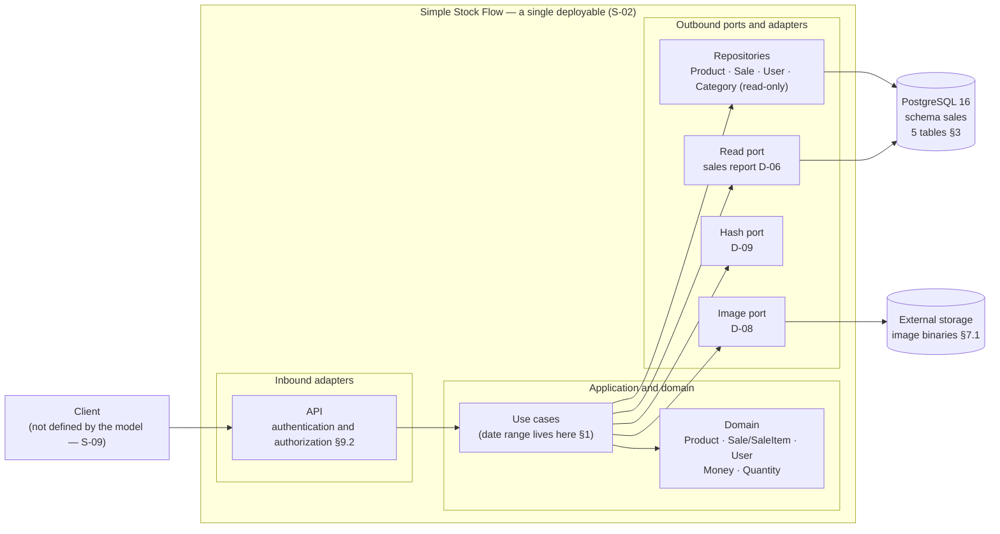

# Architecture — Simple Stock Flow

> **Single source:** [`spec/data-model.md`](../spec/data-model.md). Citations follow the format «§2.3» (section), `FK-2` (foreign-key policy, §5), `D-06` / `DP-02` / `H-1` / `T-12` (decisions, gaps and tasks the model names) and `ADR-002` (decisions the model cites).
> **Assumption** = something that does not come from the model. Each carries an identifier `S-nn` and is explained in [`../assumptions.md`](../assumptions.md).
> **Status:** closed. Checked against 01–04 and against the model in [`verification.md`](verification.md) (step 6 of the challenge).

---

## 1. What the model imposes on the architecture

The model describes storage, not a system. But what it says about *where each rule lives* forces certain shapes. This is the reading:

| What the model says | Architectural consequence | Citation |
|---|---|---|
| A single `sales` schema «groups the entire system»; five tables, three aggregate roots | A single data store and a single consistency boundary. No data split between services | §3, §2 |
| There are «ports», «adapters», «the hexagon», a «read port» and a «hash port» | **Hexagonal** style: domain at the center, dependencies pointing inward | §1, §2.5, §0 |
| Rules have three marks: **engine**, **domain-only**, **pending** | Integrity is split across layers (defense in depth). It must be decided and documented in which layer each rule lives | «How to read», §4 |
| «If the constraint trips, something wrote outside the adapter» | The database is the **last barrier**, not the first. The application validates before | «How to read», ADR-002 |
| `xmin` is the concurrency witness; D-04 | **Optimistic concurrency** over the `Product` aggregate | §3, D-04, ADR-002 |
| The report «is not persisted: it is computed in the engine through a read port» | A read path **separate** from the write path for the report, with no domain model in between | §1, D-06, ADR-004 |
| The image is an opaque key; the binary lives «in external storage» | An **external dependency** behind a port, outside the database transaction | §1, §7.1, D-08 |
| «The hash is produced by a port» and the domain never sees the plaintext password | A password **hash port**; the domain only handles the result | §2.5, D-09 |
| «The schema is owned by EF migrations and nothing else» | DDL comes **only** from versioned migrations, never from infrastructure scripts | §3.2, ADR-001 |
| The initial administrator is created by «application startup, with environment credentials» | A **startup** step in the application and per-environment configuration; no secret in the repository | §9.2, article IX |
| Authorization «lives in the API» | The **access policy** belongs to the inbound adapter, not the database nor the domain | §9.2 |

---

## 2. Adopted style

**Style:** **hexagonal architecture (ports and adapters)** in a **single deployable** [ASSUMPTION S-02: the model does not state how many processes exist; it is inferred from the single schema and the single API repository, §3 and §12].

**Why:**

1. Business invariants are expressed as domain methods (`Product.Withdraw`, `Sale.AddItem`, `Sale.EnsureConfirmable`, `User.NormalizeUsername`) and the model requires them to remain exercisable without a database (§2). That is only possible with the domain isolated from the adapters.
2. The model always distinguishes «the domain» from «the persistence adapter» and from «the API» (§0, §2, §9.2).
3. Nothing in the model asks to separate processes: no aggregate references another's data except by root identity (§5) and the three roots share schema and migrations (§3.2).

**Discarded alternative — microservices per aggregate.** It would make it costly to coordinate stock withdrawal and sale registration, which the model declares **a single operation** (§2.3, `Sale.AddItem` calls `Product.Withdraw`). Splitting `Product` and `Sale` into different processes would turn that operation into a distributed transaction. The model has no evidence that it is needed.

**What is not adopted, and why:** no event mechanism, queues or full CQRS. The model defines no events ([`../02-domain/domain-events.md`](../02-domain/domain-events.md)) and the only read/write separation it asks for is the report's (D-06).

---

## 3. Component map

**Map rules:**

- Arrows point inward: the domain does not know EF, Postgres or storage (§0: «translating from one to the other is the persistence adapter's responsibility»).
- The **report read port** queries the engine directly and does not go through `Sale` (§1, ADR-004). It is the only path that skips the domain model, and that is deliberate.
- Image storage **does not take part in the database transaction** (§7.1). The architecture does not promise atomicity between the two.

---

## 4. Aggregates and persistence ports

| Aggregate | Root | Internal entities | Persistence port | Notes | Citation |
|---|---|---|---|---|---|
| Catalog | `Product` | — (`Money` and `Quantity` are value objects, no table) | Product repository | Soft delete, never physical deletion. Optimistic concurrency (`xmin`) | §2.2, D-07 |
| Reference | `Category` | — | **Read-only** repository | Not a root nor has a lifecycle. Five seeded rows; no port creates, renames or deletes them | §2.1, D-10 |
| Sales | `Sale` | `SaleItem` (`internal` constructor; only `Sale.AddItem` invokes it) | Sale repository | Immutable once registered: **no** edit or delete port exists | §2.3, §2.4 |
| Identity | `User` | — | User repository | Exact-name lookup at every login (Q10) | §2.5, §6.1 |

**Aggregates cross each other only by root identity** (§5, cardinalities table): `product` → `category`, `sale_item` → `product`, `sale` → `user`. No aggregate contains another.

---

## 5. Ports

### 5.1 Inbound (what the system offers)

Derived from the real access patterns (§6.1). The stories backing them are in [`../04-requirements/user-stories.md`](../04-requirements/user-stories.md).

| Capability | Access pattern | Frequency | US |
|---|---|---|---|
| Authenticate | Q10 user by name | High | US-AUTH-001 |
| Seller registration | write on `User` | — | US-AUTH-002 |
| Search products (partial text, category, active only, ordered by name, paginated) | Q1 | High | US-CAT-002 |
| Get product / products by batch | Q2, Q3 | High | US-CAT-002, US-SAL-001 |
| List categories | Q4, Q5 | High / Medium | US-CAT-003 |
| Create and modify product, soft delete, image | write on `Product` | — | US-CAT-001, US-CAT-004, US-CAT-005 |
| Register sale | Q3 → write of `Product` and `Sale` | High | US-SAL-001 |
| Query a sale with its lines | Q6 | Medium | US-SAL-002 |
| List sales by range (paginated) | Q7 | High | US-SAL-003 |
| Sales report by product | Q9 | **High, the most costly** | US-REP-001 |

**Q8 (sales by range, unpaginated) has no consumer** if the report aggregates in the engine. The model asks to **remove it from the port** instead of leaving it as a trap (§6.1). This architecture does not include it.

### 5.2 Outbound (what the system needs)

| Port | What it does | Who implements it | Citation |
|---|---|---|---|
| Repositories (4) | Persist and retrieve aggregates | Persistence adapter (EF, mapping) | §0, §2 |
| Report read | Aggregate by product over a range, in the engine | Read adapter over PostgreSQL | §1, D-06 |
| Password hash | Produce and verify the hash; the domain never sees the plaintext | Security adapter | §2.5, D-09 |
| Image storage | Save and delete binaries; return the opaque key | External storage adapter | §1, §7.1, D-08 |

Identifiers are UUIDs **generated by the application** and all values are set by the domain, never by the engine (§3, §5). That is why the domain needs access to ID generation and to the current time of the sale (`sold_at`) [ASSUMPTION S-11: the model does not say whether they are ports or domain services; left to implementation].

---

## 6. Where each rule lives

This is the central table. **Mark** is the model's (engine / domain-only / pending); **Layer** is the piece of this architecture that enforces it.

| Rule | Layer that enforces it | Model mark | Citation |
|---|---|---|---|
| `product.stock >= 0` | Domain (`Product.Withdraw`/`Restock`) **and** `CHECK ck_product_stock_non_negative` | **engine** (last barrier) | §2.2, §4, ADR-002 |
| Withdrawing more stock than available fails | Domain (`Product.Withdraw`) | **domain-only** (process rule, does not fit a `CHECK`) | §2.2 |
| `price > 0` | Domain (`Product.ChangePrice`) | **domain-only** · moves to the engine with T-20 | §2.2, §4 |
| Product name required, non-empty, trimmed | Domain (`Product.Rename`); `NOT NULL` in the engine | **domain-only** (the «non-empty») | §2.2 |
| Category required and existing | `FK-1` in the engine + `Product.SetCategory` | **engine** | §2.2, §5 |
| `image_key` absent ⇒ `NULL`, never an empty string | Domain (`Product.AttachImage` normalizes) | **domain-only** | §2.2 |
| Product soft delete | Shadow property `deleted_at` + global filter in the persistence adapter | **engine** since T-09 | §2.2, §13 D-1 |
| Sale with at least one line | Domain (`Sale.EnsureConfirmable`) | **domain-only** (does not fit a `CHECK`; would need a deferred trigger) | §2.3 |
| A product is not repeated in the same sale | Domain (`Sale.AddItem`) **and** unique index `(sale_id, product_id)` | **domain-only and engine** | §2.3, §13 D-2 |
| Withdrawing stock and adding the line are a single operation | Domain (`Sale.AddItem` calls `Product.Withdraw`); the transaction is opened by the use case [ASSUMPTION S-12] | **domain-only** | §2.3 |
| Immutable sale | **Absence** of an edit or delete port | **domain-only** | §2.3, §7.1 |
| Line name and price frozen | Domain (`Sale.AddItem` copies from `Product`) | **domain-only**, by construction | §2.4 |
| Line category frozen, no foreign key | `SaleItem` constructor + `NOT NULL`; **no FK on purpose** | **engine** (T-11) | §2.4, D-06, ADR-004 |
| The line does not exist outside its sale | `FK-2` with `ON DELETE CASCADE` + `sale_id NOT NULL` | **engine** | §2.4, §5 |
| A line is never orphaned from the catalog | `FK-3` with `RESTRICT` | **engine** (T-20) | §5, §13 D-2 |
| `quantity > 0` | Domain (`Quantity` constructor) | **domain-only** · T-20 | §2.4 |
| Total and subtotal are computed, not stored | Domain (`Sale.Total`, `SaleItem.Subtotal`); **no column** | by design (article VII) | §1 |
| Unique username | Unique index `IX_user_username` | **engine** | §2.5 |
| Username lowercase and trimmed | Domain (`User.NormalizeUsername`) | **domain-only** · T-20 | §2.5 |
| `role` ∈ {`admin`, `seller`} | Domain (`Roles.IsValid`) | **domain-only** · T-20 | §2.5 |
| The password never reaches the domain in plaintext | Hash port | by hexagon design | §2.5, D-09 |
| Who can register users and who the `admin` role | **API** (authorization policy) | outside the data model | §9.2, DP-04 |
| Range end ≥ range start | Application («date range» value object) | no table | §1 |
| Report grouped by `product_id, product_name, category_name` | Read port over the engine | decision H-1 | §11.1 |
| Price and rounding match between `Money` and `numeric(18,2)` | Domain (`Money`: 2 decimals, `AwayFromZero`) **and** column | deliberate coupling | §2.2 |
| Sale authorship is not orphaned | `FK-4` toward `user` | **pending (T-12)** | §5 |

**Reading the table.** Of the 26 rules in the table, most protect the application and not the data: any manual `INSERT` skips those marked **domain-only** (§«How to read»). That concrete debt has tasks (T-20 and T-12) and this architecture **does not hide it**: the diagram of §3 leaves it to the persistence adapters and the migrations.

---

## 7. Decisions the model cites

The model refers to decisions that are **not delivered** (`plan.md`, `adr/`). Only what the model itself says about them can be reconstructed. The rest is marked as not recoverable.

| Decision | What the model lets us state | Effect on this architecture | Citation |
|---|---|---|---|
| ADR-001 | DDL is produced only by EF migrations | No infrastructure script defines schema; `pg_trgm` is installed in the same migration as its index | §3.2, §6.2 |
| ADR-002 | Optimistic concurrency; `stock >= 0` as last barrier | `xmin` as witness in `Product`; the `CHECK` exists though the domain already validates | §3, §4 |
| ADR-003 | Product soft delete; `FK-3` as last-resort barrier | `deleted_at` + global filter; physical deletion must fail loudly | §2.2, §5 |
| ADR-004 | Aggregated and frozen report | The report is not persisted and uses frozen labels | §2.4, §11.1 |
| D-03 | `deleted_at` is a shadow property, with no property on the aggregate | The `Product` aggregate does not know soft delete exists | §3 |
| D-04 | `xmin` as concurrency witness | See ADR-002 | §3 |
| D-05 | Single-currency system | No currency column or type | §1, §3 |
| D-06 | Report computed in the engine through a read port; frozen `category_name` with no FK | Separate read port | §1, §2.4 |
| D-07 | Value objects have no table; they live in their owner's row | `Money` and `Quantity` are columns of `product` and `sale_item` | §2 |
| D-08 | The image is an opaque key, not a binary or a path | External storage port | §1 |
| D-09 | The hash is produced by a port | Hash port | §2.5, §9.2 |
| D-10 | Five fixed categories, seeded, no maintenance | Read-only category repository | §1, §2.1 |
| D-01, D-02 | **The model says nothing** about their content | Cannot be reconstructed | §«Governed by» |

---

## 8. Persistence and migrations

- **Convention:** the five tables in singular (`category`, `product`, `sale`, `sale_item`, `user`) inside the `sales` schema. What becomes singular is the table, never the schema, so the qualified form is `sales.sale` (§0).
- **Code collections in plural** (`Sale.Items`, `DbSet<Product> Products`): they name sets of objects. The persistence adapter translates (§0).
- **Schema object names:** what EF generates keeps its style (`PK_`, `IX_`, `FK_`); what is hand-written (today only the `CHECK`s) uses `ck_{table}_{rule}` (§3.1).
- **No column has a `DEFAULT`:** values are set by the domain (§3). That is why the model discards `created_at`/`updated_at` and their trigger (§8).
- **Seed:** the five categories go in the initial migration with fixed identifiers (§9.1). The initial administrator does **not** go in SQL: it is created by startup with environment credentials (§9.2).
- **Pending indexes (T-13):** `product (category_id, name)` partial over active, `product (name)` with trigrams partial over active and unique `sale_item (sale_id, product_id)` with `INCLUDE`; in addition `IX_sale_item_sale_id` is dropped (§6.2). `pg_trgm` is not installed and the index's own migration installs it (§6.2).

---

## 9. Cross-cutting concerns

| Concern | What the model requires | Citation |
|---|---|---|
| **Authentication** | Bearer credential: without it the API answers 401 [ASSUMPTION S-08: the model does not name the mechanism] | §13 D-3 |
| **Authorization** | Two roles, `admin` and `seller`. The `admin` role is not granted at runtime: the deployment provisions it. An administrator registers sellers; a `seller` gets 403 when trying | §2.5, §9.2, DP-04 |
| **Secrets** | No credential versioned in the repository; the initial administrator comes from the environment | §9.2, article IX |
| **Personal data** | `username` and `sold_by` are personal data: they do not appear in anonymous responses or public endpoints. `password_hash` **never** in logs, responses, projections or error messages, and is never indexed | §7 |
| **Report privacy** | The report aggregates by product and **not by seller** | §7.1, DP-02 |
| **Retention** | Sales and lines: never deleted or edited. Products: soft delete. Image binary: the only data physically deleted | §7.1 |
| **Images** | Mandatory order on deletion: first `image_key` is set to null and the transaction committed; then the binary is deleted. Atomicity is not promised | §7.1 |
| **Errors, observability, performance** | **The model defines nothing.** No figures are invented (see NFRs in `04`) | S-07 |

---

## 10. Outside this document

By the model's own declaration (§12): the API contract (`api-contract.md`), business requirements and acceptance criteria (`spec.md`), the decisions D-01…D-10 and the testing strategy (`plan.md`). None is delivered. What is mentioned here about them comes **only** from what the model says.
